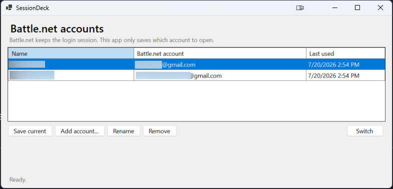

# SessionDeck

Switch between Battle.net accounts without signing in each time. SessionDeck uses sessions that the Battle.net launcher has already kept signed in.

**Windows 11 x64 · Portable · No installer or separate .NET runtime needed**

> Work in progress: features and saved-data formats may change. Keep access to your account recovery methods.



## Download

Download [SessionDeck.exe](https://github.com/slatkisasa/sessiondeck/releases/latest/download/SessionDeck.exe) from the [latest release](https://github.com/slatkisasa/sessiondeck/releases/latest) and open it. No administrator access is needed.

The app is not code-signed, so Windows may show a SmartScreen warning. Download it only from this repository.

<details>
<summary>Verify your download</summary>

Download [checksums-sha256.txt](https://github.com/slatkisasa/sessiondeck/releases/latest/download/checksums-sha256.txt) into the same folder, then run these commands in PowerShell. The SHA-256 values should match.

```powershell
Get-FileHash .\SessionDeck.exe -Algorithm SHA256
Get-Content .\checksums-sha256.txt
```

The executable includes the .NET Desktop Runtime, which accounts for much of its size.

</details>

## Use it

### Save accounts

1. Sign in to Battle.net with **Stay logged in** enabled.
2. Open SessionDeck, click **Save current**, and give the account a recognizable name.
3. To add another account, click **Add account...** and confirm that Battle.net may close and reopen.
4. Sign in to the other account with **Stay logged in** enabled, then return to SessionDeck and click **Save current**.

Repeat steps 3–4 for each additional account.

### Switch accounts

Select an account and click **Switch**, or double-click it. SessionDeck closes Battle.net, selects the saved account in its configuration, and restarts the launcher.

**Rename** changes the name shown in SessionDeck. **Remove** removes the SessionDeck entry; it does not delete your Battle.net account.

## Your data

Battle.net manages the signed-in sessions. SessionDeck does not collect passwords, authentication tokens, cookies, or browser profiles. It makes no network calls and sends no telemetry.

SessionDeck reads account identifiers from `%APPDATA%\Battle.net\Battle.net.config`. When switching, it moves the chosen identifier to the front of `Client.SavedAccountNames`, preserving other settings and backing up the configuration first.

Its local files are stored under `%LOCALAPPDATA%\SessionDeck`:

- `accounts.json` — saved names and account identifiers, which may be email addresses.
- `Backups` — Battle.net configuration backups.

These files can contain private information. Do not share them publicly, and protect access to your Windows account.

## Troubleshooting

| Problem | What to try |
| --- | --- |
| An account opens at the sign-in screen | Its session may have expired. Sign in with **Stay logged in** enabled, then use **Save current** again. |
| **Save current** cannot find an account | Finish signing in to Battle.net, close the launcher, reopen SessionDeck, and try again. |
| Buttons are unavailable | Make sure Battle.net is installed and has been opened at least once. |

To uninstall, delete `SessionDeck.exe`. To also remove its saved names and backups, delete `%LOCALAPPDATA%\SessionDeck`. This does not uninstall Battle.net or delete a Battle.net account.

[Report a problem](https://github.com/slatkisasa/sessiondeck/issues) with a description of what happened. Do not attach private configuration files, account data, or unedited screenshots containing personal information.

## Build and contribute

With the [.NET 8 SDK](https://dotnet.microsoft.com/download/dotnet/8.0) installed, run `.\build.ps1` in PowerShell on Windows. The portable executable is written to `dist\SessionDeck.exe`.

See [CONTRIBUTING.md](CONTRIBUTING.md) for verification commands and the pull request process, or [TODO.md](TODO.md) for planned improvements.

## License

Copyright © 2026 [slatkisasa](https://github.com/slatkisasa). Licensed under [GNU AGPLv3](LICENSE.md). Covered modifications must retain the license notices and make their corresponding source available under the same license.

SessionDeck is an independent project, not affiliated with or endorsed by Blizzard Entertainment.
